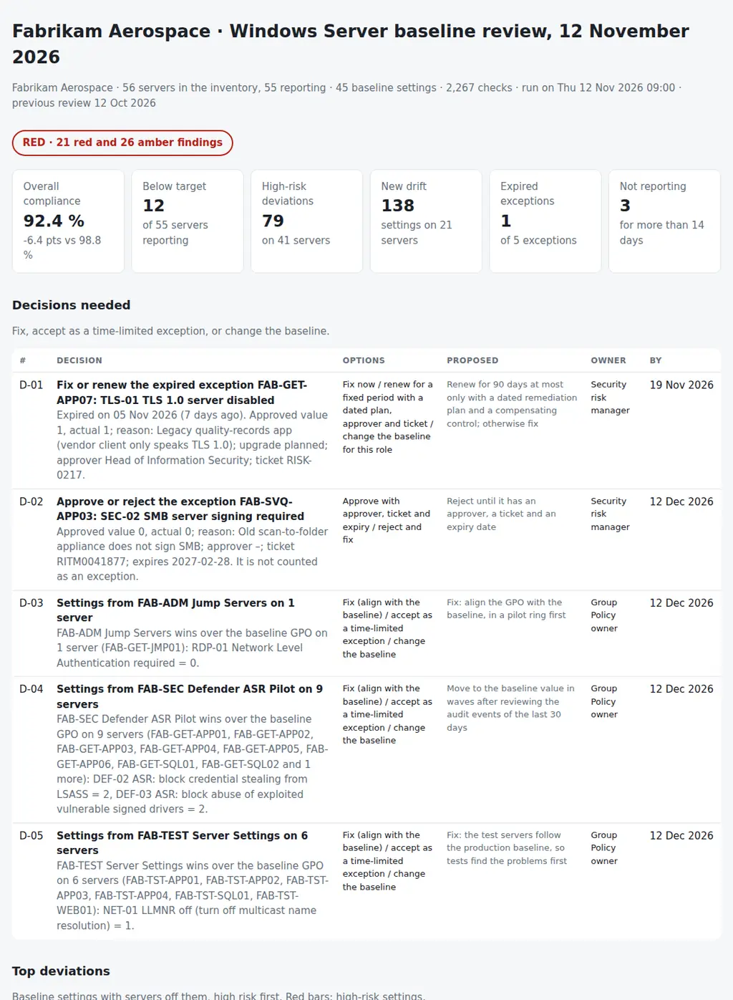

# Windows Server Baseline Drift

The question for the Windows team and security every month: are our Windows servers still configured the way the approved security baseline says, which ones have drifted since the last review, why (a GPO not applying, a local change, an exception that expired), and what do we fix first? From the baseline, the server inventory from AD or the CMDB, the settings collected from every server, last month's collection, the exceptions register and the Group Policy results, it puts together:

- **Compliance:** every applicable baseline setting on every server, by tier and role, with the compliance % per server, area, tier, site and environment, and the servers below target.
- **High risk first:** SMBv1, LM and NTLMv1, LLMNR, RDP without NLA, LAPS, Defender real-time protection and ASR rules in audit where block is expected, logon and lockout auditing, PowerShell script block logging, the Print Spooler on domain controllers, TLS 1.0 and 1.1 and firewall profiles.
- **Drift:** settings that were compliant at the last review and are not now, grouped by cause, and local changes that override the GPO.
- **Root cause:** GPOs not applied and why (not linked, link disabled, security filtering, WMI filter), servers in an OU that is not their tier's, settings won by another GPO, and exceptions that expired, are about to expire or have no approver or ticket.
- **Hygiene:** servers not reporting for weeks, long uptime, old patches, and the inventory against the collection.

Every finding has an owner and a due date, every expired exception and every GPO that overrides the baseline becomes a decision, **fix, accept as a time-limited exception or change the baseline**, and the pack carries the evidence an ISO 27001 or NIS2 auditor asks for: **which servers are off the baseline, since when, why, and what we fix first.**

Python 3.10+, standard library only. It runs with fictional demo data out of the box. A read-only PowerShell collector reads the baseline settings from each server (registry, audit policy, services, firewall, SMB, Defender and ASR, user rights, LAPS in AD) and the Resultant Set of Policy.

The review sits next to two earlier repos in the series: [19-ad-infra-health-check](https://github.com/inigogonzalezgarcia/19-ad-infra-health-check) checks that Active Directory and the infrastructure services behind these servers are healthy, and [39-vulnerability-remediation-sla](https://github.com/inigogonzalezgarcia/39-vulnerability-remediation-sla) follows the vulnerabilities that a patch fixes; this one follows the configuration that a patch does not.



## Why

A security baseline is approved once and then drifts one reasonable change at a time. In a typical month with sixty Windows servers:

- a scanner integration needs SMBv1 and someone turns it back on, locally, on the two file servers;
- seven servers are moved to a new OU for a project, and the baseline GPO is not linked there, so LLMNR, NTLM, TLS 1.0 and RDP settings quietly fall back to the defaults;
- the new servers are not in the LAPS group, and their local administrator password is the one in the build;
- a GPO for the test environment turns LLMNR back on "to make the tests work";
- the Print Spooler is set to automatic on a domain controller after an incident;
- the jump server GPO allows RDP without NLA for an old client;
- an ASR pilot left two rules in audit on nine servers months ago;
- the exception for TLS 1.0 on an old application server expired last week, and the application is still there;
- three servers have not reported for three weeks, so nobody knows;
- an exception was "approved" in a ticket without an approver;
- PowerShell script block logging is off on a whole site because a GPO link was disabled during troubleshooting.

The data to see all of this exists, on the servers and in Group Policy. The review reads it together with the baseline, last month's collection and the exceptions, gives each deviation its probable cause, and turns the result into a short list of fixes and decisions. The rules are in `settings.json` and `baselinedrift/checks.py`.

## What it checks

| Area | Code | Finding | Severity |
|---|---|---|---|
| High risk | RISK-HIGH | A high-risk setting off the baseline on one or more servers | RED |
| Deviations | DEV-SETTING | Any other setting off the baseline | AMBER |
| Drift | DRF-NEW | Compliant (or excepted) at the last review and not now, grouped by cause | AMBER / RED with a high-risk setting |
| Drift | DRF-LOCAL | A value set locally that overrides the GPO | AMBER |
| Group Policy | GPO-NOTAPPLIED | A baseline GPO not applied, with the reason (not linked, link disabled, security filtering, WMI filter) | AMBER / RED when it carries high-risk settings |
| Group Policy | GPO-OU, GPO-OTHER | Server in an OU that is not its tier's; a baseline setting won by another GPO | AMBER |
| Exceptions | EXC-EXPIRED | Exception expired and the deviation still there | AMBER / RED on a high-risk setting |
| Exceptions | EXC-EXPIRING, EXC-INCOMPLETE | Expiring within 30 days; no approver, ticket or expiry (it does not count) | AMBER |
| Compliance | CMP-SERVER | Servers below their tier's target (95 %, 100 % for tier 0); below 80 % | AMBER, RED |
| Hygiene | HYG-STALE | Servers with no collection for more than 14 days | AMBER / RED for tier 0 |
| Hygiene | HYG-NOTCOLLECTED, HYG-UNKNOWN | In the inventory with no collection; collected but not in the inventory | AMBER |
| Hygiene | HYG-UPTIME, HYG-PATCH | Up for more than 60 days; last patch older than 45 days | AMBER |

Approved, valid exceptions count as compliant; incomplete or expired ones do not. The cause of each deviation is the first that applies: the baseline GPO is not applied, the exception expired, the exception is incomplete, a local change, another GPO, not configured, or the baseline GPO itself sets a different value. The source of each value comes from the collector and is a hint: the review says "probable cause", and the owner confirms it before changing anything.

## Outputs

| File | What |
|---|---|
| `report.html` | Tiles (overall compliance and the change since the last review, servers below target, high-risk deviations, new drift, expired exceptions, servers not reporting), the decisions, the top deviations with their causes, compliance per tier, site and environment, the trend per area, a heat map of servers by area, the exceptions and every finding |
| `review-pack.md` | One page for the monthly security and infrastructure review: headlines, decisions needed (fix, exception or baseline change), high-risk items with owner and date, compliance, other actions, the audit evidence summary, scope and notes |
| `server-compliance.csv` | One row per server: state, last collection, compliant, exceptions, deviations, not configured, compliance %, target, high risk, new drift, risk score, main cause |
| `deviations.csv` | One row per server and setting off the baseline (exceptions included): expected, actual, source, GPO, status, new drift, cause, exception, reference, owner |
| `drift.csv` | What changed since the last review: new drift, resolved, other changes and new servers |
| `exceptions-review.csv` | Every exception with its state (valid, expiring, expired, incomplete, value differs, not needed) and the action |
| `findings.csv` | Every finding with severity, group, servers, detail, action, owner and due date |
| `actions.csv` | Every finding as an action with a reference, owner, due date and done column |

## Try it

```bash
git clone https://github.com/inigogonzalezgarcia/51-windows-server-baseline-drift.git
cd 51-windows-server-baseline-drift
python -m baselinedrift demo
```

Open `output/report.html` and `output/review-pack.md`.

### The demo data

The demo is a made-up aerospace parts manufacturer, Fabrikam Aerospace, with two sites, Getafe and Sevilla, and 56 Windows servers in the inventory: 4 domain controllers in tier 0 and 52 member servers in tier 1, 6 of them test servers. The baseline has 45 settings in 12 areas, 17 of them flagged high risk. The review runs on Thursday 12 November 2026; the previous one was on 12 October:

- 2,308 collected values from 56 servers, 2,103 from last month, 5 exceptions and 346 Group Policy results.

Everything is fictional: servers, GPOs, people, tickets and values. The problems are placed on purpose among servers that follow the baseline:

- **SMBv1** turned back on locally on the two file servers by a legacy scanner integration.
- **GPO not linked:** 7 engineering servers moved to a new OU that has no link to the server baseline GPO.
- **LAPS** missing on the 4 new servers, which are not in the LAPS GPO's security filtering group.
- **LLMNR** on in the 6 test servers, set by a test GPO.
- **Print Spooler** set to automatic on one domain controller.
- **RDP without NLA** on the Getafe jump server, set by the jump server GPO.
- **ASR rules in audit** on 9 servers where block is expected, from a pilot GPO that was never closed.
- **TLS 1.0** on an old application server whose exception expired on 5 November.
- **Not reporting:** 3 servers with no collection for 20 to 24 days; one more server in the inventory never collected, and one collected that the inventory no longer has.
- **An exception with no approver** for SMB signing on an application server.
- **PowerShell script block and module logging off** on the Sevilla member servers, after the GPO link was disabled.

The result: **RED**; compliance **92.4 %**, down from 98.8 % at the last review, on 55 of 56 servers and 2,267 checks; 12 servers below target, the 7 moved servers at 61 %; **79 high-risk deviations on 41 servers** across 11 high-risk settings; **138 settings drifted since the last review on 21 servers**, 112 of them from the GPO that is not linked; 3 GPO results with a baseline GPO not applied; 1 expired exception of 5; 3 servers not reporting; 21 red and 26 amber findings; 5 decisions.

## Use it with your own data

1. Write your baseline in `data/baseline.csv` (one row per setting, with its type, path, expected value, comparison, severity, tier, GPO and reference) and export `data/servers.csv` from AD or the CMDB with tier, site, OU, owner, environment, last patch and last reboot.
2. Collect the settings (read-only), from an admin workstation of the right tier:
   ```powershell
   Move-Item .\data\settings.csv .\data\previous.csv -Force     # last month's collection, for the drift
   .\scripts\Collect-BaselineSettings.ps1 -Baseline .\data\baseline.csv -Servers .\data\servers.csv -OutputFolder .\data
   ```
   - For each server it opens one remoting session (`Invoke-Command` over WinRM) and reads, by type: `Get-ItemProperty` for registry values, `auditpol /get /category:* /r` for the audit policy, `Get-Service`, `Get-NetFirewallProfile -PolicyStore ActiveStore`, `Get-SmbServerConfiguration`, `Get-MpComputerStatus` and `Get-MpPreference` (the ASR rule actions: 0 off, 1 block, 2 audit, 6 warn), and `secedit /export /areas USER_RIGHTS` to a temporary file that is read and deleted. LAPS: `Get-ADComputer` with `msLAPS-PasswordExpirationTime` (only the expiry time, never the password).
   - Group Policy: `Get-GPResultantSetOfPolicy -Computer <server> -ReportType Xml`, parsed for each GPO's IsValid, FilterAllowed and AccessDenied; a baseline GPO missing from the RSoP is reported as not linked or link disabled. `Get-GPRegistryValue` on the applied GPOs tells which one sets a policy value.
   - Modules: ActiveDirectory and GroupPolicy (RSAT) on the workstation; local administrator rights on the servers. Credentials come from the current session or `Get-Credential` and stay in memory; nothing is set, linked or restarted.
   - It writes `settings.csv` and `gpo-results.csv`. Keep `exceptions.csv` from your exceptions register and adjust `data/settings.json`: review dates, targets per tier, the OUs of each tier, thresholds and owners ([docs/data-format.md](docs/data-format.md) has every column and setting).
3. Build the outputs:
   ```bash
   python -m baselinedrift review data/
   ```

[docs/baseline-review-runbook.md](docs/baseline-review-runbook.md) has the monthly cycle, how to read the result (coverage, causes, high risk, drift), when to fix, accept an exception or change the baseline, how to pilot a baseline change in audit mode first without breaking applications, the exception rules, and the evidence for ISO 27001 and NIS2 audits.

The collection contains server names, OUs and security settings. Keep it inside your organisation:

- real files at the top level (`baseline*.csv`, `servers*.csv`, `settings*.csv`, `previous*.csv`, `exceptions*.csv`, `gpo-results*.csv`, `settings.json`, `data/`, `downloads/`) and the `output/` folder are excluded from Git by `.gitignore`;
- only the fictional files in `sample_data/` are committed.

## Tests

```bash
pip install -r requirements-dev.txt
python -m pytest -q
```

GitHub Actions runs them on Python 3.10 and 3.12 on every push, then rebuilds the fictional sample data and the report screenshot from the simulator.

14 tests: loading the baseline with other column names, comparisons, severities and tiers; the comparisons (numbers, booleans, lists, user-right SIDs); the inventory, environments, sources and server names; compliance with exceptions, missing values and the target per tier; high-risk and other deviations; the cause of each deviation; new drift, resolved settings and new servers against the previous review; GPOs not applied, wrong OUs and settings won by another GPO; every exception state; servers not reporting, coverage, uptime and patch age; the order, owners, due dates and decisions; missing files and the smallest input; the demo end to end (deterministic, all eight outputs, every planted finding); and a check that the collector only reads.

## Next steps

- Run it on the first working day of every month, and after every change to a baseline GPO.
- Keep each month's compliance per area to show the trend over the year at the security committee.
- Read the Defender for Endpoint secure configuration assessment or the configuration scanner the company already has as another source of values.
- Add the Windows Server 2025 settings and the per-role baselines (IIS, SQL Server, file servers) as separate `AppliesTo` groups.
- Open the RED actions as tickets in the ITSM tool with the owner and due date.

## Background

Built from my work running Windows servers and their security:

- Windows Server administration, including DNS and DHCP, Active Directory and Group Policy, from early in my career; patching Windows servers without cutting the service; PowerShell automation;
- applied experience with ISO 27001, GDPR and NIS2, and with NIST CSF and NIST SP 800-53; cybersecurity risk management (analysis, treatment plans and remediation follow-up), security policies, metrics and KPIs;
- Microsoft Defender, Intune EPM, CyberArk, Tanium and Qualys, and Conditional Access;
- answering audits, the CMDB, and process ownership for incident, change and problem.

Written from scratch with fictional data; no employer data, systems or exports are used.

## Customisation and contact

Want this adapted to your environment? For example:

- your baseline, its references and the tiers and roles it applies to;
- your collection source: this collector, Tanium, Defender for Endpoint or your configuration scanner;
- your targets, exception rules and owners;
- the pack in the format of your monthly security review.

Get in touch:

- Website (contact form): [inigogonzalezgarcia.github.io](https://inigogonzalezgarcia.github.io/about.html#contacto)
- LinkedIn: [linkedin.com/in/igonzalez93](https://www.linkedin.com/in/igonzalez93)

## License

MIT
